<h1 align="center">Retro98</h1>

<p align="center"><strong>A Windows 98–style environment for macOS that never gets in the way of your work.</strong></p>

<p align="center">
  
  
  <a href="LICENSE"></a>
</p>

<p align="center"><a href="README.pt-BR.md">Leia em português</a></p>

<p align="center">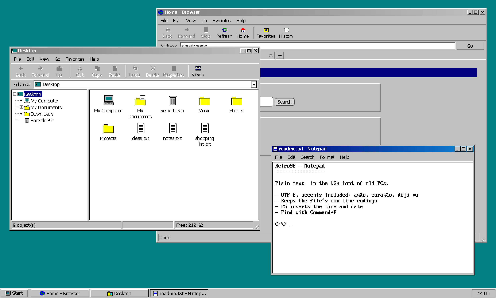</p>

macOS doesn't accept system themes, so Retro98 isn't a theme. It is a set of reversible macOS tweaks plus original 98-style apps that run on top of macOS and live alongside it. Everything can be undone in one step.

> Inspired by Windows 98. Not affiliated with or endorsed by Microsoft. All images and sounds are original.

## What you get

- **A taskbar and a Start menu** with one button per open window, a clock, and your own apps under Programs.
- **Retro apps that do real work:** a file manager, a terminal, a plain-text editor, a control panel and a web browser.
- **Your Mac stays a Mac.** Finder, Terminal, Safari, the Dock and every shortcut keep working. Each piece can be turned off on its own.
- **One command to go back:** `./uninstall.sh` restores every setting it changed.
- **Built on your Mac** from source, with no developer account.

| | |
|---|---|
| **Explorer** — browse, copy, move, rename and search your files, with the Recycle Bin and Properties.<br>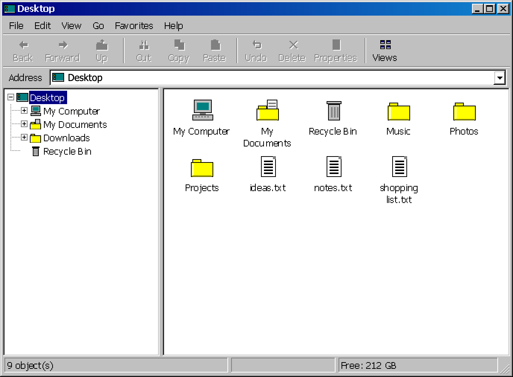 | **Browser** — a retro frame with tabs around the WebKit that comes with macOS.<br>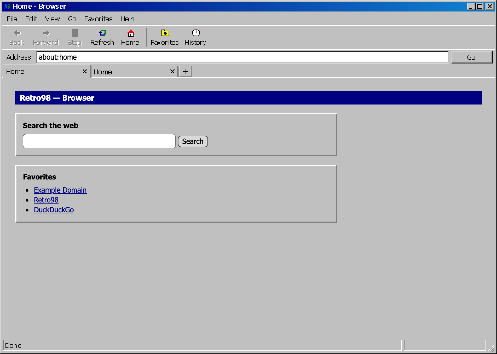 |
| **Notepad** — plain UTF-8 text in a crisp VGA font, with retro open and save dialogs.<br>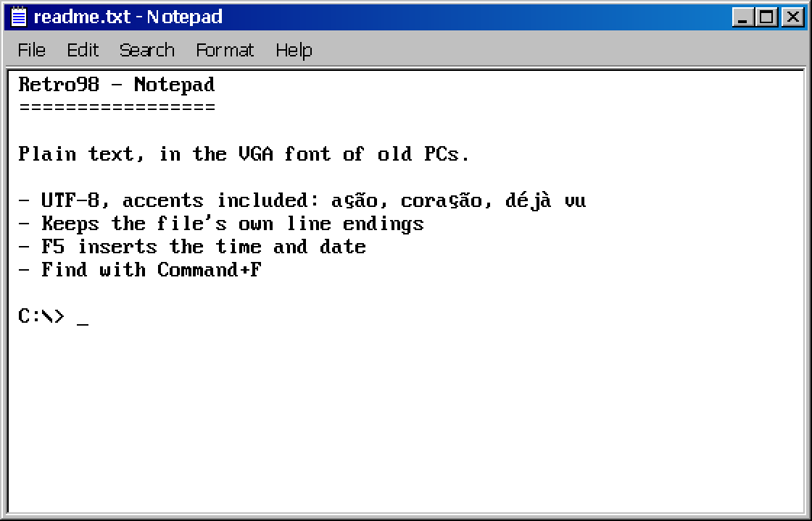 | **Control Panel** — wallpaper, appearance, sounds, screen saver, and a switch for each piece.<br>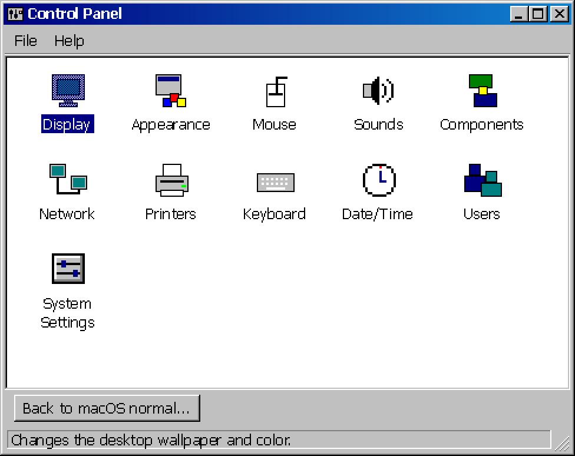 |

There is also a **Prompt** (a full terminal in the classic PC font) and **themes** for Chrome, Sublime Text and Terminal.

<sub>The pictures are drawn off screen by `scripts/make-screenshots.sh` from the real app windows with made-up content. The first one is a composition of those windows over the desktop color, not a capture of a screen.</sub>

## Quick start

```bash
git clone https://github.com/matheushchaves/retro98.git
cd retro98
./install.sh        # asks which pieces you want
./uninstall.sh      # puts everything back
```

You need macOS 14 or newer and the Xcode Command Line Tools (`xcode-select --install`). The first build takes a few minutes.

## Status

| Phase | What | State |
|---|---|---|
| 1 | Base tweaks | ✅ available |
| 2A | Visual kit + taskbar and Start menu | ✅ available |
| 2B | Window buttons on the taskbar, hidden Dock | ✅ available |
| 2C | Desktop icons | replaced by the Explorer's Desktop (the macOS desktop and widgets stay as they are) |
| 3A | Explorer: browse files | ✅ available |
| 3B | Explorer: copy, move, rename, delete | ✅ available |
| 3C | Explorer: views, search, Open With, Properties | ✅ available |
| 4 | Prompt (terminal) | ✅ available |
| 5 | Control Panel | ✅ available |
| 6 | Notepad | ✅ available |
| 7 | Themes for Chrome, Sublime Text and Terminal.app | ✅ available |
| 8 | Retro web browser (WebKit) | ✅ available |
| 9 | Screen savers (3D Pipes, 3D Text, a castaway's island) | ✅ available |

## Requirements

- macOS 14 (Sonoma) or newer. Developed and tested on macOS 27 (Apple Silicon).
- Xcode Command Line Tools: `xcode-select --install`

## Install

```bash
git clone https://github.com/matheushchaves/retro98.git
cd retro98
./install.sh
```

The installer asks which pieces you want (base tweaks, taskbar with the Explorer, the Prompt, the Notepad, the themes for other apps, the Browser), builds everything on your Mac (no developer account, no "unidentified developer" warning), saves the original value of every setting it is about to change, and then installs them. `./install.sh --yes` repeats your previous choices (or installs everything the first time); a new piece, like the Browser, comes in unless you declined it before. The Control Panel is always installed, and what you change in it survives `./install.sh --yes` (see below).

## Uninstall

```bash
./uninstall.sh
```

This puts back every original value. Retro98's files are removed **only** if everything was restored. If something could not be restored, the backup stays in `~/Library/Application Support/Retro98/` and you can run `./uninstall.sh` again.

If the themes were installed, the uninstaller removes their files and tells you what is left to remove inside Chrome and Terminal (see [Themes](#themes-phase-7)).

The Browser's favorites and history are yours and stay: the uninstaller removes the app and tells you which folder they are in (see [Browser](#browser-phase-8)). To clear site logins and cookies, use Go › Clear Browsing Data… before uninstalling.

## Taskbar and Start menu (Phase 2A)

A 98-style taskbar at the bottom of your main screen:

- **Start** opens the Start menu: Programs (every app on your Mac, in its folders), Documents (recently opened files), Settings (System Settings), Help, Run… (open an app, folder, document or web address by name) and Shut Down… (shut down, restart, log out or sleep).
- **Control-Escape** (⌃⎋) opens and closes the Start menu.
- The right corner shows volume, battery and the clock (hover for the date); clicking opens the matching System Settings pane.
- The Dock is hidden while the taskbar runs (it never pops up or shows labels); ⌘Tab still works. It comes back exactly as it was when you uninstall.
- If the taskbar crashes, it comes back by itself. If it crashes 3 times within a minute, it turns itself off and gives the Dock back.
- To keep the base tweaks but remove the taskbar, run `./install.sh` again and answer "n" to the taskbar question.

The first time you use Shut Down…, macOS asks whether Retro98 Shell may control System Events.

## Window buttons (Phase 2B)

- One button per open window on the current Space, with the app's icon and the window title.
- Click a button to bring its window forward; click the active window's button to minimize it; click a minimized window's button to restore it.
- Right-click a button for Restore, Minimize and Close.
- Maximized, "Fill" and tiled windows stop at the top of the taskbar instead of going under it.

These need **Accessibility** permission. The first time, Retro98 Shell explains and opens System Settings › Privacy & Security › Accessibility: turn on Retro98 Shell. You only do this once: the installer signs the Shell with a local certificate (kept in its own keychain, `~/Library/Keychains/retro98-signing.keychain-db`), so macOS remembers the permission across updates. Uninstalling removes that keychain and clears Retro98's permissions in Privacy & Security, so installing again after an uninstall asks once more. If the taskbar shows no windows while Retro98 Shell is already on in that list, remove it with − and add it again with + (it's in `~/Applications/Retro98`).

## Explorer (Phase 3)

Retro98 Explorer is a 98-style file manager installed with the taskbar (`~/Applications/Retro98/Retro98 Explorer.app`). It's a separate app: Finder keeps working as always.

- Open it from the quick launch button next to Start, from Start › Programs › Retro98 › Retro98 Explorer, or with a link: `open retro98-explorer://desktop` (also `retro98-explorer://my-computer` and `retro98-explorer://folder?path=/Applications`).
- It opens on the **Desktop**: My Computer, My Documents, Recycle Bin and the files in your Desktop folder. Your macOS desktop and widgets are not touched.
- On screen: folder tree on the left, toolbar, address bar and status bar (objects, selection size, free space). In the address bar, type a path (`~/Downloads`) or a place name ("My Computer"); its arrow lists the folders above the current one.
- My Computer lists your disks, USB drives and network volumes, and updates when you plug one in or eject it. Open folders refresh by themselves when their files change.
- Double-click, ⌘O or ⌘↓ opens: folders open in place, files and apps open in their usual macOS app. The space bar previews the selection with Quick Look.

### Viewing and searching (3C)

- **Views:** large icons, small icons, list and details (⌘1 to ⌘4, the View menu or the Views button). The list scrolls sideways. In Details, the Name, Size, Type and Modified columns sort with a click, and a second click reverses; View › Arrange by… does the same in the other views. The view and the order apply to every window and are remembered.
- **Hidden files:** View › Show Hidden Files (⇧⌘.). They show faded, as in 98.
- **Search** (⌘F): opens the "Search for" bar under the address. Typing filters the folder right away; with **Include subfolders**, the search goes into subfolders in the background (up to 5,000 results) and Details gains an "In Folder" column. **Stop** interrupts and Esc closes. **Start › Find…** opens a window already searching your home folder.
- **Properties** (⌘I or ⌥↩︎): type, location, size (computed in the background for folders), what a folder contains and the dates. For disks and USB drives, used and free space.
- **Open With:** right-click › Open With, with the default app first and "Other…" to pick any app. Also in File › Open With….
- **Eject** (⌘E): in My Computer, for USB drives and network volumes. If the disk is in use, the reason shows up.

### Working with files (3B)

- **Copy, cut and paste** work together with Finder: copy on one side and paste on the other. A cut item looks faded until you paste, and pasting moves it. **⌥⌘V** moves what was copied (in the Explorer or in Finder), like Finder's "Move Item Here".
- **Drag and drop** between Explorer windows, to and from Finder, and from other apps (photos from Photos, Mail attachments). On the same disk a drag moves; to another disk it copies. Hold **⌥** to copy or **⌘** to move. Dropping on a folder, My Documents, a disk or the Recycle Bin sends the items there.
- **Rename** with **Enter** or **F2** (or the context menu). The name without its extension comes selected; changing the extension asks first. **New Folder** (⇧⌘N) starts out renaming.
- **Delete** (⌘⌫ or Del) asks, then sends to the macOS Trash. **Delete Permanently** (⌥⌘⌫ or ⇧Del) asks, then deletes for good. In the Recycle Bin window, **Restore** puts items back where they came from, and **Empty Recycle Bin** (⇧⌘⌫) asks, then empties it.
- **Replace:** when an item with the same name exists, the Explorer asks (Yes, Yes to All, No, Cancel) and shows the size and date of both. The replaced item goes to the Trash; it doesn't vanish.
- **Long operations** show a progress dialog with Cancel; the window stays usable meanwhile. Cancelling never leaves a half-copied file.
- **Undo** (⌘Z, or the Undo button) covers the whole app: it undoes paste, move, rename, new folder, delete and restore; ⇧⌘Z redoes. Undoing a copy sends the copy to the Trash, as in Finder.
- Right-click opens the context menu for an item or the window background.
- Limits: "Restore" only knows what the Explorer itself sent to the Trash (the rest goes back with Finder's "Put Back"; macOS doesn't offer that to other apps). The Recycle Bin window shows and empties only your disk's Trash; Finder empties items deleted from USB drives. Dragging from Photos or Mail isn't undoable.
- **Full Disk Access (optional, only for the Recycle Bin):** macOS protects the Trash folder: seeing it needs this, and restoring, emptying or undoing a delete may need it. The installer opens System Settings › Privacy & Security › Full Disk Access and shows the app in Finder: turn on Retro98 Explorer (or drag it into the list). Without it, the Recycle Bin window offers "Open in Finder".

### Explorer shortcuts

| Action | Keys |
|---|---|
| Back, Forward, Up | ⌘[ · ⌘] · ⌘↑ or Backspace |
| Open | double-click, ⌘O or ⌘↓ |
| Desktop, My Computer, My Documents, Downloads | ⇧⌘D · ⇧⌘C · ⇧⌘O · ⌥⌘L |
| Large icons, small icons, list, details | ⌘1 · ⌘2 · ⌘3 · ⌘4 |
| Show hidden files | ⇧⌘. |
| Search | ⌘F (Esc closes) |
| Properties | ⌘I or ⌥↩︎ |
| Eject | ⌘E |
| Copy, cut, paste | ⌘C · ⌘X · ⌘V |
| Move what was copied | ⌥⌘V |
| Undo, redo | ⌘Z · ⇧⌘Z |
| New folder | ⇧⌘N |
| Rename | Enter or F2 |
| Send to the Recycle Bin | ⌘⌫ or Del |
| Delete permanently | ⌥⌘⌫ or ⇧Del |
| Empty Recycle Bin | ⇧⌘⌫ |
| Refresh, new window, close, select all | ⌘R · ⌘N · ⌘W · ⌘A |

### Explorer instead of Finder (optional)

When another app asks to "Show in Finder" (Safari's downloads, for example), macOS can open Retro98 Explorer instead, with the file already selected.

- **Turn on:** the installer asks when you choose the taskbar; the default answer is No.
- **Turn off:** run `./install.sh` again and answer No, or uninstall. Finder is put back before the Explorer leaves the disk.
- **Limits:** apps that were already open may need to be reopened to notice the change. Opening a folder with a double-click in other apps still goes to Finder. A switch in the Control Panel comes in Phase 5.

## Prompt (Phase 4)

Retro98 Prompt is a full terminal in a 98-style window (`~/Applications/Retro98/Retro98 Prompt.app`): light gray text on black in a classic VGA font, drawn pixel-sharp. It runs your own shell (`$SHELL`, as a login shell, like Terminal), so your aliases, prompt and tools are all there.

- **Open it** from Start › Programs › Retro98 › Retro98 Prompt, from Spotlight, or with `open -a "Retro98 Prompt"`. The installer asks about it separately from the taskbar (default Yes).
- **Windows, not tabs:** ⌘N opens another window; each one is its own shell. Closing a window (⌘W, or the × button) while a program runs (vim, ssh, a build) asks first; an idle shell closes right away, and typing `exit` closes the window. Quitting asks once if any window has a program running.
- **Everyday terminal things:** copy and paste with ⌘C/⌘V (select with the mouse), 10,000 lines of scrollback with the retro scroll bar or the trackpad, ANSI and 256 colors, Unicode and accents. Option types characters (é, ã, ü) instead of acting as Meta. Resize the window and the lines follow.
- **It doesn't replace Terminal:** Terminal stays the app that opens `.command` and `.sh` files, and nothing about it changes. A Terminal profile with the same look comes in Phase 7.

| Action | Shortcut |
|---|---|
| New window, close | ⌘N · ⌘W |
| Copy, paste, select all | ⌘C · ⌘V · ⌘A |
| Minimize | ⌘M |

## Control Panel (Phase 5)

Retro98 Control Panel (`~/Applications/Retro98/Retro98 Control Panel.app`) turns Retro98's pieces on and off without the terminal. Open it from Start › Settings › Control Panel, from Spotlight, or with `open -a "Retro98 Control Panel"`; Settings… (⌘,) brings its window back.

- **Display:** the macOS wallpaper, one of 16 solid colors, or a picture of your own. The picture is copied into Retro98's folder, so moving the original later doesn't break it.
- **Appearance:** each Phase 1 tweak on its own check box. The wallpaper is in Display and the pointer in Mouse.
- **Mouse:** the white pointer with a black outline.
- **Sounds:** Retro98's own sounds (taskbar startup, errors, warnings, emptying the Recycle Bin), made by the project, each with a Play button. You can turn them off, and you can make Retro98's alert the macOS alert sound: it goes to `~/Library/Sounds/Retro98.aiff` and shows as "Retro98" in System Settings › Sound.
- **Screen Saver:** which screen saver, how long to wait, a Preview button and the castaway's sound; see [Screen savers](#screen-savers-phase-9).
- **Components:** the taskbar and Start menu, Explorer instead of Finder for "Show in Finder", and a hidden macOS menu bar (it shows when you move the pointer to the top). A piece that isn't installed is grayed out, with how to install it.
- **Shortcuts to macOS:** Network, Printers, Keyboard, Date/Time, Users and System Settings open the matching panel.
- **Back to macOS normal…** turns every piece off and restores every saved setting; Retro98's apps stay installed. `./install.sh --yes` then keeps macOS normal; run `./install.sh` and answer Yes to bring the retro look back, or run `./uninstall.sh` to remove the apps too.

What you change here sticks: `./install.sh --yes` keeps the tweaks you turned off off, brings back the color or picture you chose, and keeps a taskbar you turned off off (the pieces file says `shelloff`) while still updating the apps. Turn things back on in the Control Panel itself.

## Notepad (Phase 6)

Retro98 Notepad (`~/Applications/Retro98/Retro98 Notepad.app`) is a plain-text editor in a 98-style window: black text on white in the same pixel-sharp VGA font as the Prompt, with no formatting and none of macOS's automatic substitutions (curly quotes, dashes, spelling correction), so the file holds exactly what you typed.

- **Open it** from Start › Programs › Retro98 › Retro98 Notepad, from Spotlight, or with `open -a "Retro98 Notepad" file.txt`. It is also listed in **Open With** for text files, in Finder and in the Explorer, without becoming the default app for `.txt`. The installer asks about it separately ("Install the Notepad?", default Yes).
- **Files:** it reads and writes UTF-8. Saving keeps the line breaks the file already had (Windows, Unix or old Mac) and its byte-order mark, if it had one. A file in another encoding, a binary file or one over 10 MB doesn't open: a message says why, and nothing is changed.
- **Open and Save As** use Retro98's own retro dialogs: the "Look in" list with the Desktop, the disks and My Documents, the up-one-level button, the file name and the type (`*.txt` or all files). The name field also takes a path, such as `~/notes` or `/tmp/log.txt`. They don't create folders: use the Explorer for that.
- **Windows:** one per document. Open reuses a window that is still empty; a file that is already open just comes to the front. Closing or quitting with changes asks whether to save.
- **Search:** Find looks down or up from the cursor, matching case or not, and tells you when there is no match.
- **Format › Word Wrap** applies to every window and is remembered.
- **Not in this phase:** printing. TextEdit still opens the same files.

| Action | Shortcut |
|---|---|
| New, open, save, save as | ⌘N · ⌘O · ⌘S · ⇧⌘S |
| Undo, redo | ⌘Z · ⇧⌘Z |
| Cut, copy, paste, select all | ⌘X · ⌘C · ⌘V · ⌘A |
| Time/Date | F5 |
| Find, find next | ⌘F · ⌘G |
| Close | ⌘W |

## Themes (Phase 7)

Three apps you already use get the 98 look. Retro98 **never edits those apps' settings**: the installer leaves the files ready in `~/Library/Application Support/Retro98/Themes/` (the folder opens in Finder the first time) and you turn each theme on in the app itself. The installer asks about them separately ("Install the themes for Chrome, Sublime Text and Terminal?", default Yes).

| App | What it looks like | To turn on | To turn off |
|---|---|---|---|
| **Chrome** | Navy gradient frame (gray when the window is inactive), gray toolbar, teal new tab page | Open `chrome://extensions`, turn on **Developer mode** and drag the `Chrome` folder onto the page | Remove "Retro98" in `chrome://extensions` |
| **Sublime Text** | Gray interface in Tahoma with a navy selection; black code on white, blue keywords, green comments | Preferences › Select Theme… › Retro98 and Preferences › Select Color Scheme… › Retro98 | Pick another theme and scheme in the same menus |
| **Terminal** | "Retro98 Prompt" profile: gray on black, the console colors and the VGA font, 80×25 | Double-click `Retro98 Prompt.terminal` | Delete the profile in Terminal › Settings › Profiles |

- **Chrome:** the theme is loaded straight from the folder, so the folder has to stay there. If Chrome warns about developer-mode extensions, this is why.
- **Sublime Text:** the package goes to `Packages/Retro98/` in Sublime Text's data folder, and is installed only if Sublime Text is already on the Mac. The theme changes only colors and the font of the default theme.
- **Terminal:** the default profile doesn't change. For Terminal to use the VGA font, the installer copies it to `~/Library/Fonts/`, only if it isn't there yet; a font you already had is never replaced or deleted.

## Browser (Phase 8)

Retro98 Browser (`~/Applications/Retro98/Retro98 Browser.app`) is a 98-style frame around the WebKit that comes with macOS, the same engine as Safari. The frame is retro (menus, toolbar, address, tabs and status bar); pages look the way they do today.

**It is a secondary browser.** It doesn't use Chrome extensions and doesn't share logins with Chrome or Safari. It has no password manager and no passkeys, and it doesn't use the camera, the microphone or your location. It never offers itself as the default browser of macOS.

- **Open it** from Start › Programs › Retro98 › Retro98 Browser, from Spotlight, or with `open -a "Retro98 Browser" https://example.com`. It also shows up in **Open With** for HTML files. The installer asks about it separately ("Install the Browser (WebKit engine)?", default Yes).
- **Address:** type an address (`example.com`), a path (`~/site/index.html`) or anything else, which becomes a DuckDuckGo search. `localhost`, numeric addresses and `.local` names open over `http://`; everything else gets `https://`.
- **Tabs:** the "+" button or ⌘T opens a tab on the home page. ⌘-click on a link opens it in the background, and a link that would open another window becomes a tab. Closing the last tab closes the window. Tabs are not reopened next time.
- **Home page:** a page of the browser's own, with a search box and your favorites. Go › Use the Current Page as Home picks another.
- **Downloads** go to the Downloads folder, with a progress dialog and Cancel. A download never replaces a file: if the name is taken, it becomes `name (2).ext`. File › Open the Downloads Folder shows the folder.
- **Favorites and history** are kept in `~/Library/Application Support/Retro98/Browser/`. Favorites › Organize Favorites… renames, reorders and deletes; Go › History… lists the pages you visited, with a filter. Go › Clear Browsing Data… clears the history and the site data (cookies, cache and logins) and keeps the favorites.
- **Links to other apps** (`mailto:`, meetings, stores): the browser asks before opening another app.
- **Limits:** pages that ask for a password in the browser's own window (HTTP authentication) and JavaScript's `prompt()` have no dialog. Certificate errors can't be bypassed. There are no suggestions while you type an address.

| Action | Shortcut |
|---|---|
| New window, new tab | ⌘N · ⌘T |
| Go to the address, open a file | ⌘L · ⌘O |
| Close tab, close window | ⌘W · ⇧⌘W |
| Back, forward, home | ⌘[ · ⌘] · ⇧⌘H |
| Stop, refresh | ⌘. · ⌘R |
| Next tab, previous tab | ⌃⇥ · ⌃⇧⇥ (or ⇧⌘] · ⇧⌘[) |
| Tab 1 to 8, last tab | ⌘1 to ⌘8 · ⌘9 |
| Zoom in, zoom out, actual size | ⌘+ · ⌘− · ⌘0 |
| Find on the page, find next | ⌘F · ⌘G |
| Add to Favorites, History | ⌘D · ⌘Y |
| Open the Downloads folder | ⌥⌘L |

## Screen savers (Phase 9)

When the mouse and the keyboard sit still for a while, the taskbar covers every screen with a screen saver. Pick it in Control Panel › Screen Saver.

| | |
|---|---|
| **3D Pipes**<br>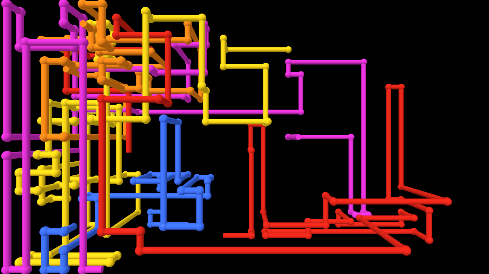 | **3D Text**<br>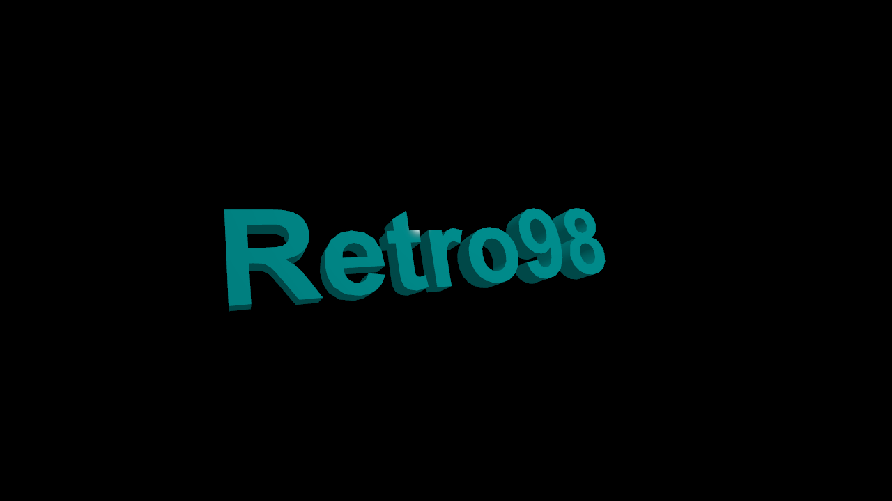 |
| **Johnny Castaway** fishing<br>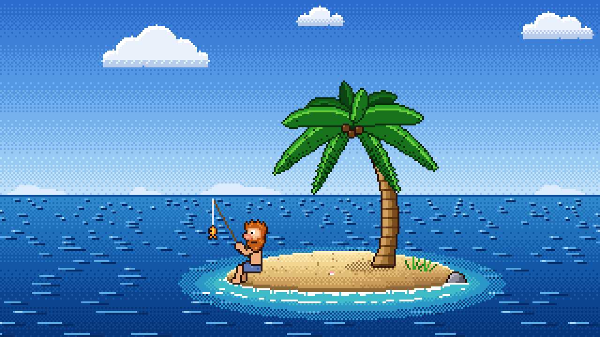 | Napping<br>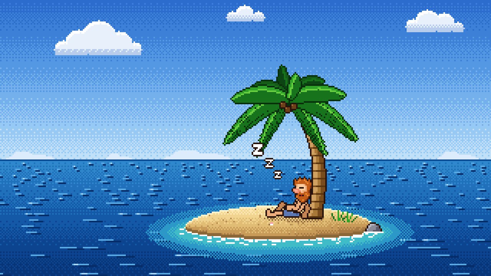 |
| A shark goes by<br>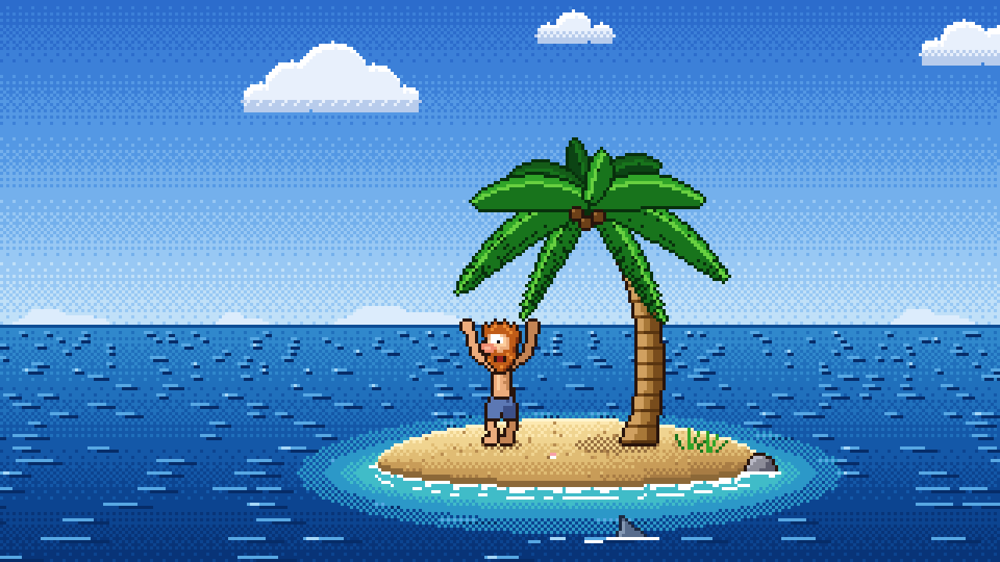 | A gull goes by<br>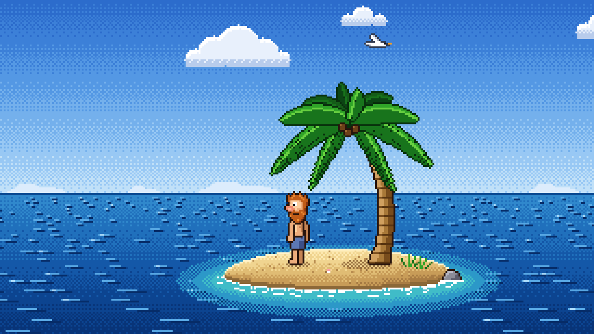 |

- **3D Pipes** (the default): colored pipes grow through the dark until they fill most of the screen, then start over.
- **3D Text:** "Retro98" in solid letters, slowly tumbling.
- **Johnny Castaway:** a castaway on a tiny island with one palm tree. He naps, fishes, panics at a passing shark, watches a gull fly by and stretches, while the waves roll and the clouds drift. The character, the pixel art and the sounds were made for Retro98; nothing comes from the 1992 screen saver.
- **"(None)"** turns the screen saver off.
- **Wait:** 1, 2, 5 (the default), 10, 15, 20 or 30 minutes without the mouse or the keyboard.
- **Preview** shows the chosen screen saver right away, without waiting and without saving.
- **With sound** (the castaway only, off by default): the surf in the background, plus a snore, the float's plop, a low suspense sting for the shark, the gull's cry and a yawn. It's separate from "Play Retro98 sounds", and every sound is synthesized by the project, with no recordings.
- **Leaving:** moving the mouse, pressing a key, clicking or scrolling brings your desktop back and stops the sound.

The screen saver runs inside the taskbar (Retro98 Shell), so it needs the taskbar installed and on; changes count once you click Apply. It doesn't touch the macOS screen saver or the lock screen, which keep their own settings in System Settings.

## What Phase 1 changes

| Id | Tweak | What changes |
|---|---|---|
| `wallpaper` | Retro98 wallpaper | Wallpaper becomes solid `#008080` (or the color or picture chosen in the Control Panel) on every screen |
| `lightAppearance` | Light mode | Light appearance, automatic switching off |
| `colors` | Graphite accent and navy selection | Graphite accent color, `#000080` text selection |
| `contrast` | Reduced transparency and increased contrast | Opaque menus and sidebars, outlined controls |
| `pointer` | White pointer with black outline | Pointer fill white, outline black |
| `scrollBars` | Always-visible scroll bars | Scroll bars never auto-hide |
| `windowAnimations` | No window animations | Windows open and close instantly |
| `titleBarDoubleClick` | Double-click title bar to maximize | Double-click fills the screen |
| `finderExplorer` | Explorer-like Finder | Status bar, path bar, all file extensions, folders first, list view, new windows open your home folder |

Apply or undo individual tweaks with the installed tool:

```bash
TOOL="$HOME/Library/Application Support/Retro98/bin/retro98-settings"
"$TOOL" status
"$TOOL" apply --only colors,pointer
"$TOOL" restore --only lightAppearance
```

## Permissions and known issues

- To switch to light mode right away, macOS may ask whether **Terminal can control System Events**. If you decline, light mode still takes effect after you log out and back in.
- The Accessibility tweaks (`contrast`, `pointer`) need **Full Disk Access** for the terminal app you run the installer from. If macOS refuses them, the tool opens **System Settings › Privacy & Security › Full Disk Access**: turn on your terminal app and run the same command again. Every other tweak still gets applied. Use the same terminal app to uninstall.
- The Control Panel needs the same **Full Disk Access** to change `contrast` and `pointer`. If macOS refuses, it says so and offers to open the panel: turn on Retro98 Control Panel there and apply again. Its first switch to light mode makes macOS ask whether Retro98 Control Panel can control System Events.
- The hidden menu bar and the alert sound use macOS settings Apple doesn't document. If one of them only takes effect after you log out and back in, that's macOS, not a failed change.
- Some apps only show the new colors, scroll bars or animation setting after you quit and reopen them.

## Credits

- **Font of the Prompt, the Notepad and the Terminal profile:** PxPlus IBM VGA 8x16 from [The Ultimate Oldschool PC Font Pack](https://int10h.org/oldschool-pc-fonts/) by VileR, licensed under [CC BY-SA 4.0](https://creativecommons.org/licenses/by-sa/4.0/). The font and its license travel in `Resources/Fonts/` and inside both apps; with the themes installed, the font also goes to `~/Library/Fonts/`. It's the "Plus" version because the original code page 437 one has no ã or õ.
- **Terminal engine:** [SwiftTerm](https://github.com/migueldeicaza/SwiftTerm) by Miguel de Icaza, MIT license, vendored at 1.11.2 in `Vendor/SwiftTerm` with three small fixes taken from SwiftTerm 1.19 (crisp pixel fonts, room for our own scroll bar, noticing the shell's exit). Newer versions need Xcode's separately downloaded Metal Toolchain to build, which would break the install on most Macs; `Vendor/SwiftTerm/VENDORED.md` has the details.

## License

[MIT](LICENSE) for Retro98's own code. The Prompt font keeps its CC BY-SA 4.0 license and SwiftTerm its MIT license.
