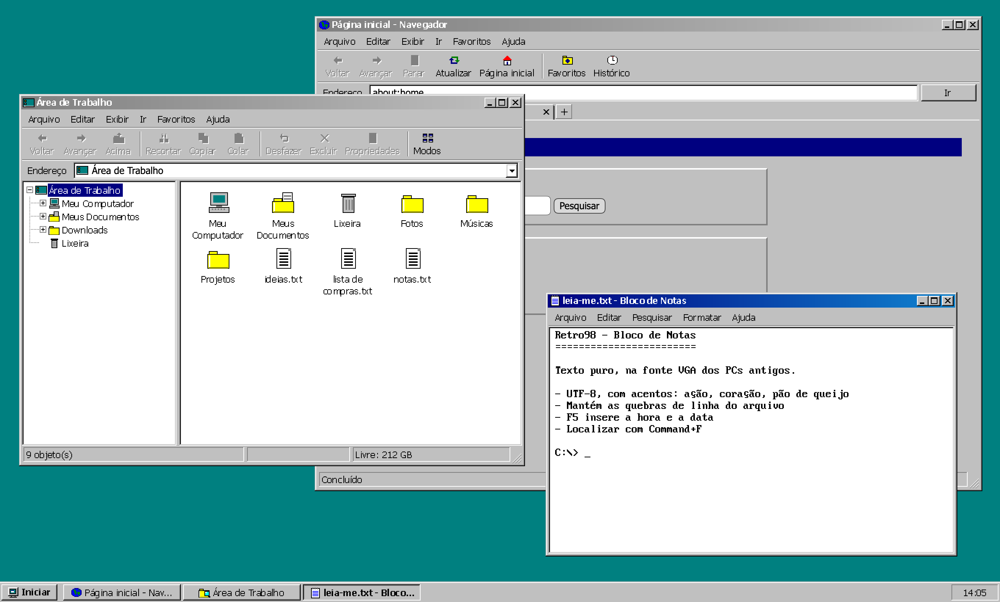
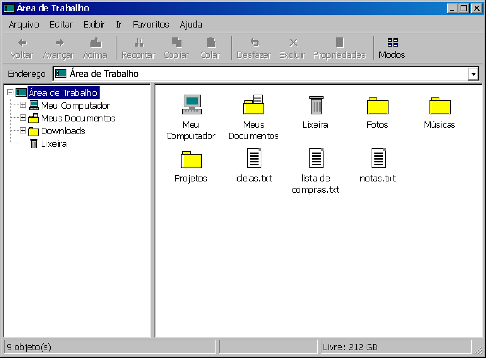
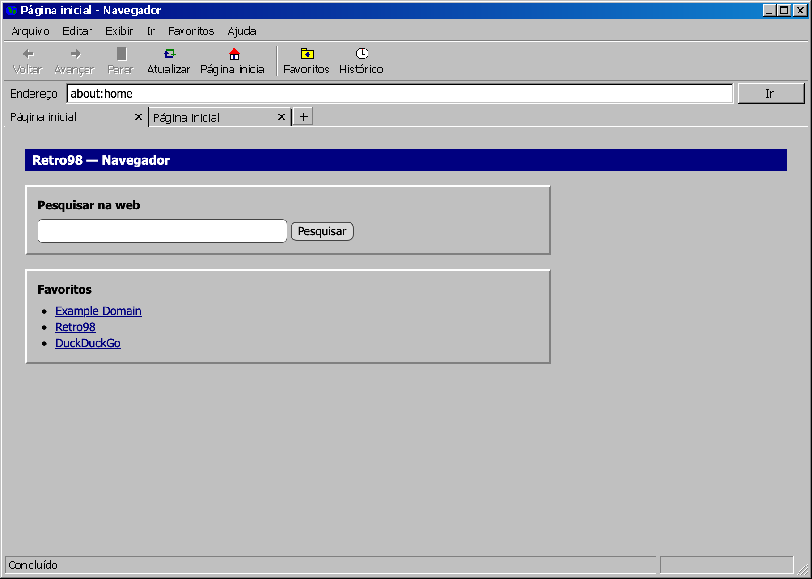
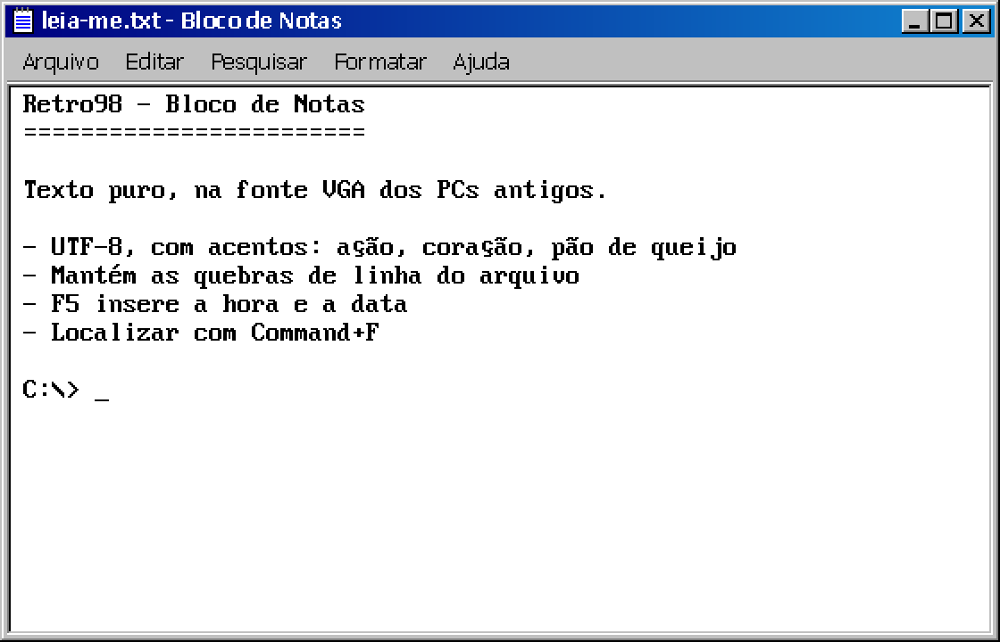
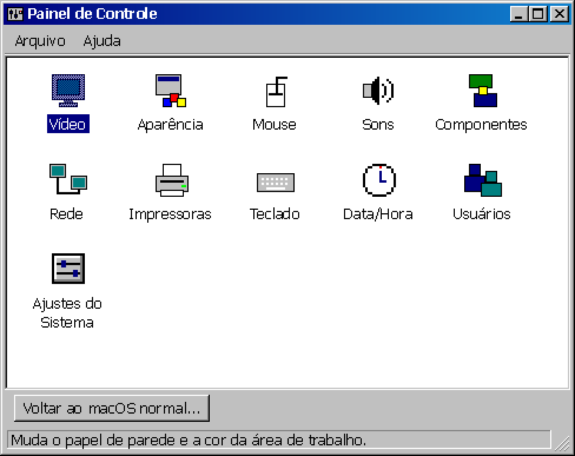
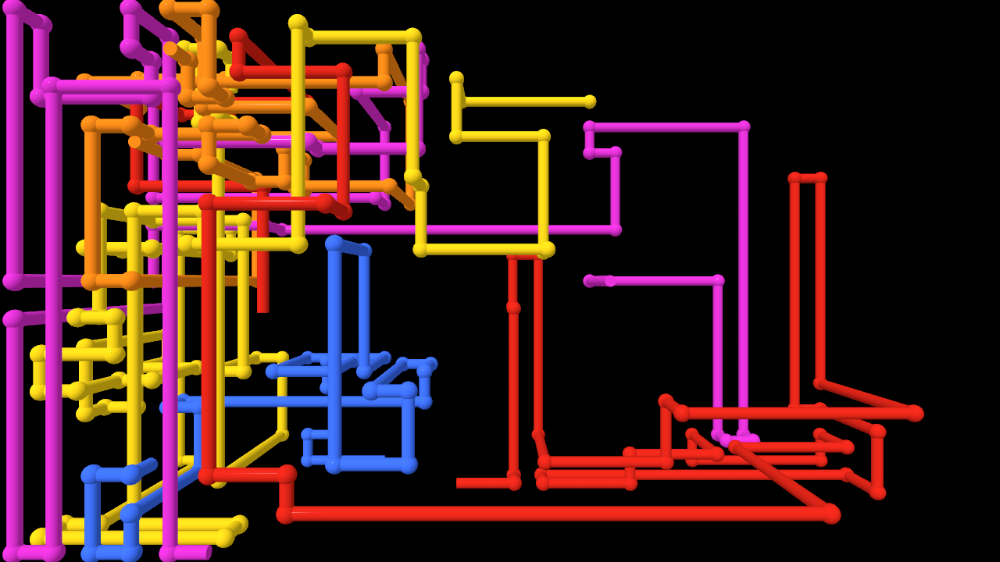
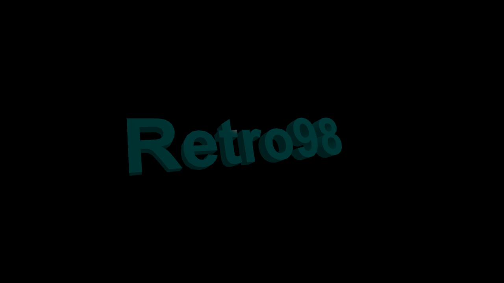

<h1 align="center">Retro98</h1>

<p align="center"><strong>Um ambiente estilo Windows 98 para macOS que nunca atrapalha o seu trabalho.</strong></p>

<p align="center">
  
  
  <a href="LICENSE"></a>
</p>

<p align="center"><a href="README.md">Read in English</a></p>

<p align="center"></p>

O macOS não aceita temas de sistema, então o Retro98 não é um tema. É um conjunto de ajustes reversíveis do macOS mais apps originais no estilo 98 que rodam por cima do macOS e convivem com ele. Tudo pode ser desfeito de uma vez.

> Inspirado no Windows 98. Sem afiliação nem endosso da Microsoft. Todas as imagens e sons são originais.

## O que você ganha

- **Barra de tarefas e menu Iniciar**, com um botão por janela aberta, relógio e os seus apps em Programas.
- **Apps retrô que trabalham de verdade:** gerenciador de arquivos, terminal, editor de texto puro, painel de controle e navegador.
- **O Mac continua sendo um Mac.** Finder, Terminal, Safari, o Dock e todos os atalhos seguem funcionando. Cada peça pode ser desligada sozinha.
- **Um comando para voltar:** `./uninstall.sh` devolve todos os ajustes que foram mudados.
- **Compilado no seu Mac** a partir do código, sem conta de desenvolvedor.

| | |
|---|---|
| **Explorer** — navegar, copiar, mover, renomear e procurar arquivos, com Lixeira e Propriedades.<br> | **Navegador** — uma moldura retrô com abas em volta do WebKit que vem com o macOS.<br> |
| **Bloco de Notas** — texto puro em UTF-8 numa fonte VGA nítida, com diálogos retrô de abrir e salvar.<br> | **Painel de Controle** — papel de parede, aparência, sons, proteção de tela e um interruptor para cada peça.<br> |

Há também um **Prompt** (um terminal completo na fonte clássica de PC) e **temas** para Chrome, Sublime Text e Terminal.

<sub>As imagens são desenhadas fora da tela pelo `scripts/make-screenshots.sh`, a partir das janelas reais dos apps com conteúdo inventado. A primeira é uma composição dessas janelas sobre a cor da área de trabalho, não a captura de uma tela.</sub>

## Começo rápido

```bash
git clone https://github.com/matheushchaves/retro98.git
cd retro98
./install.sh        # pergunta quais peças você quer
./uninstall.sh      # devolve tudo
```

Você precisa do macOS 14 ou mais novo e das Ferramentas de Linha de Comando do Xcode (`xcode-select --install`). A primeira compilação leva alguns minutos.

## Situação

| Fase | O quê | Estado |
|---|---|---|
| 1 | Ajustes base | ✅ disponível |
| 2A | Base visual + barra de tarefas e menu Iniciar | ✅ disponível |
| 2B | Botões das janelas na barra, Dock escondido | ✅ disponível |
| 2C | Ícones na área de trabalho | substituída pela Área de Trabalho do Explorer (a mesa e os widgets do macOS ficam como estão) |
| 3A | Explorer: navegar pelos arquivos | ✅ disponível |
| 3B | Explorer: copiar, mover, renomear, excluir | ✅ disponível |
| 3C | Explorer: modos de exibição, busca, Abrir com, Propriedades | ✅ disponível |
| 4 | Prompt (terminal) | ✅ disponível |
| 5 | Painel de Controle | ✅ disponível |
| 6 | Bloco de Notas | ✅ disponível |
| 7 | Temas para Chrome, Sublime Text e Terminal.app | ✅ disponível |
| 8 | Navegador retrô (WebKit) | ✅ disponível |
| 9 | Proteção de tela (Tubulações 3D, Texto 3D, Ilha Deserta) | ✅ disponível |

## Requisitos

- macOS 14 (Sonoma) ou mais novo. Desenvolvido e testado no macOS 27 (Apple Silicon).
- Ferramentas de Linha de Comando do Xcode: `xcode-select --install`

## Instalar

```bash
git clone https://github.com/matheushchaves/retro98.git
cd retro98
./install.sh
```

O instalador pergunta quais peças você quer (ajustes base, barra de tarefas com o Explorer, o Prompt, o Bloco de Notas, os temas para outros apps, o Navegador), compila tudo no seu Mac (sem conta de desenvolvedor e sem aviso de "desenvolvedor não identificado"), guarda o valor original de cada ajuste que vai mudar e depois instala. `./install.sh --yes` repete as escolhas anteriores (ou instala tudo na primeira vez); uma peça nova, como o Navegador, entra junto, a menos que você a tenha recusado antes. O Painel de Controle é sempre instalado, e o que você muda nele continua valendo depois de `./install.sh --yes` (veja abaixo).

## Desinstalar

```bash
./uninstall.sh
```

Isso devolve todos os valores originais. Os arquivos do Retro98 só são removidos **se tudo foi restaurado**. Se algo não puder ser restaurado, o backup fica em `~/Library/Application Support/Retro98/` e você pode rodar `./uninstall.sh` de novo.

Se os temas estavam instalados, o desinstalador tira os arquivos deles e avisa o que falta remover dentro do Chrome e do Terminal (veja [Temas](#temas-fase-7)).

Os favoritos e o histórico do Navegador são seus e ficam: o desinstalador remove o app e diz em que pasta eles estão (veja [Navegador](#navegador-fase-8)). Para apagar os logins e os cookies dos sites, use Ir › Limpar dados de navegação… antes de desinstalar.

## Barra de tarefas e menu Iniciar (Fase 2A)

Uma barra de tarefas estilo 98 na base da tela principal:

- **Iniciar** abre o menu: Programas (todos os apps do Mac, nas pastas deles), Documentos (arquivos abertos recentemente), Configurações (Ajustes do Sistema), Ajuda, Executar… (abre app, pasta, documento ou endereço pelo nome) e Desligar… (desligar, reiniciar, encerrar sessão ou repouso).
- **Control-Esc** (⌃⎋) abre e fecha o menu Iniciar.
- O canto direito mostra volume, bateria e relógio (passe o mouse para ver a data); clicar abre o painel correspondente dos Ajustes do Sistema.
- O Dock fica escondido enquanto a barra estiver ligada (não aparece nem mostra nomes); o ⌘Tab continua funcionando. Ele volta exatamente como era quando você desinstala.
- Se a barra cair, ela volta sozinha. Se cair 3 vezes em 1 minuto, ela se desliga e devolve o Dock.
- Para manter os ajustes base e tirar só a barra, rode `./install.sh` de novo e responda "n" na pergunta da barra.

Na primeira vez que você usar Desligar…, o macOS pergunta se o Retro98 Shell pode controlar o System Events.

## Botões de janela (Fase 2B)

- Um botão por janela aberta no Space atual, com o ícone do app e o título da janela.
- Clique num botão para trazer a janela para a frente; clique no botão da janela ativa para minimizá-la; clique no botão de uma janela minimizada para restaurá-la.
- Clique com o botão direito para Restaurar, Minimizar e Fechar.
- Janelas maximizadas, em "Preencher" ou lado a lado param no topo da barra em vez de passar por baixo dela.

Isso precisa da permissão de **Acessibilidade**. Na primeira vez, o Retro98 Shell explica e abre Ajustes do Sistema › Privacidade e Segurança › Acessibilidade: ative o Retro98 Shell. Você faz isso uma vez só: o instalador assina o Shell com um certificado local (guardado num chaveiro próprio, `~/Library/Keychains/retro98-signing.keychain-db`), então o macOS lembra a permissão entre atualizações. Desinstalar remove esse chaveiro e apaga as permissões do Retro98 em Privacidade e Segurança, então instalar de novo depois de desinstalar pede a permissão outra vez. Se a barra não mostra as janelas e o Retro98 Shell já aparece ativado nessa lista, remova-o com − e adicione de novo com + (ele fica em `~/Applications/Retro98`).

## Explorer (Fase 3)

O Retro98 Explorer é um gerenciador de arquivos no estilo 98, instalado junto com a barra de tarefas (`~/Applications/Retro98/Retro98 Explorer.app`). É um app separado: o Finder continua funcionando como sempre.

- Abra pelo botão de Início rápido ao lado do Iniciar, por Iniciar › Programas › Retro98 › Retro98 Explorer, ou por um link: `open retro98-explorer://desktop` (também `retro98-explorer://my-computer` e `retro98-explorer://folder?path=/Applications`).
- Ele abre na **Área de Trabalho**: Meu Computador, Meus Documentos, Lixeira e os arquivos da sua pasta Mesa. A mesa e os widgets do macOS não são tocados.
- Na tela: árvore de pastas à esquerda, barra de ferramentas, barra de endereço e barra de status (objetos, tamanho da seleção, espaço livre). No endereço, digite um caminho (`~/Downloads`) ou o nome de um local ("Meu Computador"); a seta lista as pastas acima da atual.
- Meu Computador mostra os discos, pen drives e volumes de rede, e se atualiza quando você pluga ou ejeta um. Pastas abertas se atualizam sozinhas quando os arquivos mudam.
- Clique duplo, ⌘O ou ⌘↓ abre: pastas abrem na própria janela, arquivos e apps abrem no app de sempre do macOS. A barra de espaço espia a seleção com o Visualização Rápida.

### Ver e procurar (3C)

- **Modos de exibição:** ícones grandes, ícones pequenos, lista e detalhes (⌘1 a ⌘4, o menu Exibir ou o botão Modos). A lista rola para o lado. Em Detalhes, as colunas Nome, Tamanho, Tipo e Modificado ordenam com um clique, e um segundo clique inverte; Exibir › Organizar por… faz o mesmo nos outros modos. O modo e a ordem valem para todas as janelas e ficam guardados.
- **Arquivos ocultos:** Exibir › Mostrar arquivos ocultos (⇧⌘.). Eles aparecem esmaecidos, como no 98.
- **Procurar** (⌘F): abre a barra "Procurar" abaixo do endereço. Digitar filtra a pasta na hora; com **Incluir subpastas**, a busca entra nas subpastas em segundo plano (até 5.000 resultados) e Detalhes ganha a coluna "Em pasta". **Parar** interrompe e Esc fecha. **Iniciar › Localizar…** abre uma janela já procurando na sua pasta pessoal.
- **Propriedades** (⌘I ou ⌥↩︎): tipo, local, tamanho (o de pastas é calculado em segundo plano), o que a pasta contém e as datas. Em discos e pen drives, o espaço usado e o livre.
- **Abrir com:** botão direito › Abrir com, com o app padrão primeiro e "Outro…" para escolher qualquer app. Também em Arquivo › Abrir com….
- **Ejetar** (⌘E): em Meu Computador, para pen drives e volumes de rede. Se o disco estiver em uso, aparece o motivo.

### Mexendo nos arquivos (3B)

- **Copiar, recortar e colar** funcionam junto com o Finder: copie de um lado e cole do outro. Um item recortado fica esmaecido até você colar, e colar move. **⌥⌘V** move o que foi copiado (no Explorer ou no Finder), como o "Mover Item Para Cá" do Finder.
- **Arrastar e soltar** entre janelas do Explorer, para o Finder e do Finder, e de outros apps (fotos do Fotos, anexos do Mail). No mesmo disco, arrastar move; para outro disco, copia. Segure **⌥** para copiar ou **⌘** para mover. Soltar sobre uma pasta, sobre Meus Documentos, sobre um disco ou sobre a Lixeira manda para lá.
- **Renomear** com **Enter** ou **F2** (ou o menu de contexto). O nome sem a extensão já vem selecionado; mudar a extensão pede confirmação. **Nova pasta** (⇧⌘N) já entra renomeando.
- **Excluir** (⌘⌫ ou Del) pergunta e manda para a Lixeira do macOS. **Excluir permanentemente** (⌥⌘⌫ ou ⇧Del) pergunta e apaga de vez. Na janela da Lixeira, **Restaurar** devolve os itens ao lugar de onde vieram, e **Esvaziar Lixeira** (⇧⌘⌫) pergunta e esvazia.
- **Substituir:** se já existe um item com o mesmo nome, o Explorer pergunta (Sim, Sim para todos, Não, Cancelar), mostrando o tamanho e a data dos dois. O item substituído vai para a Lixeira, não some.
- **Operações longas** mostram um diálogo de progresso com Cancelar; a janela continua usável enquanto isso. Cancelar não deixa arquivo pela metade.
- **Desfazer** (⌘Z, ou o botão Desfazer) vale para o app inteiro: desfaz colar, mover, renomear, nova pasta, excluir e restaurar; ⇧⌘Z refaz. Desfazer uma cópia manda a cópia para a Lixeira, como no Finder.
- O botão direito abre o menu de contexto do item ou do fundo da janela.
- Limites: "Restaurar" só conhece o que o próprio Explorer mandou para a Lixeira (o resto volta pelo "Devolver" do Finder; o macOS não oferece isso a outros apps). A janela da Lixeira mostra e esvazia só a Lixeira do seu disco; itens apagados de pen drives o Finder esvazia. Arrastar do Fotos ou do Mail não entra no Desfazer.
- **Acesso Total ao Disco (opcional, só para a Lixeira):** o macOS protege a pasta da Lixeira: ver a Lixeira precisa dele, e restaurar, esvaziar ou desfazer uma exclusão podem precisar. O instalador abre Ajustes do Sistema › Privacidade e Segurança › Acesso Total ao Disco e mostra o app no Finder: ative o Retro98 Explorer (ou arraste-o para a lista). Sem isso, a janela da Lixeira oferece "Abrir no Finder".

### Atalhos do Explorer

| Ação | Teclas |
|---|---|
| Voltar, Avançar, Acima | ⌘[ · ⌘] · ⌘↑ ou Backspace |
| Abrir | duplo clique, ⌘O ou ⌘↓ |
| Área de Trabalho, Meu Computador, Meus Documentos, Downloads | ⇧⌘D · ⇧⌘C · ⇧⌘O · ⌥⌘L |
| Ícones grandes, ícones pequenos, lista, detalhes | ⌘1 · ⌘2 · ⌘3 · ⌘4 |
| Mostrar arquivos ocultos | ⇧⌘. |
| Procurar | ⌘F (Esc fecha) |
| Propriedades | ⌘I ou ⌥↩︎ |
| Ejetar | ⌘E |
| Copiar, recortar, colar | ⌘C · ⌘X · ⌘V |
| Mover o que foi copiado | ⌥⌘V |
| Desfazer, refazer | ⌘Z · ⇧⌘Z |
| Nova pasta | ⇧⌘N |
| Renomear | Enter ou F2 |
| Mandar para a Lixeira | ⌘⌫ ou Del |
| Excluir permanentemente | ⌥⌘⌫ ou ⇧Del |
| Esvaziar Lixeira | ⇧⌘⌫ |
| Atualizar, nova janela, fechar, selecionar tudo | ⌘R · ⌘N · ⌘W · ⌘A |

### Explorer no lugar do Finder (opcional)

Quando outro app pede "Mostrar no Finder" (os downloads do Safari, por exemplo), o macOS pode abrir o Retro98 Explorer, com o arquivo já selecionado.

- **Ligar:** o instalador pergunta, quando você escolhe a barra de tarefas; a resposta padrão é Não.
- **Desligar:** rode `./install.sh` de novo e responda Não, ou desinstale. O Finder volta a ser usado antes de o Explorer sair do disco.
- **Limites:** apps que já estavam abertos podem precisar ser reabertos para perceber a troca. Abrir uma pasta com dois cliques em outros apps continua indo para o Finder. Um interruptor no Painel de Controle chega na Fase 5.

## Prompt (Fase 4)

O Retro98 Prompt é um terminal completo numa janela no estilo 98 (`~/Applications/Retro98/Retro98 Prompt.app`): texto cinza-claro sobre preto, numa fonte VGA clássica desenhada com os pixels nítidos. Ele roda o seu próprio shell (`$SHELL`, como login, igual ao Terminal), então seus atalhos, seu prompt e suas ferramentas estão todos lá.

- **Abrir:** em Iniciar › Programas › Retro98 › Retro98 Prompt, pelo Spotlight ou com `open -a "Retro98 Prompt"`. O instalador pergunta por ele separado da barra de tarefas (a resposta padrão é Sim).
- **Janelas, não abas:** ⌘N abre outra janela, cada uma com o seu shell. Fechar uma janela (⌘W ou o botão ×) com um programa rodando (vim, ssh, um build) pergunta antes; um shell parado fecha na hora, e digitar `exit` fecha a janela. Encerrar o app pergunta uma vez se alguma janela tiver programa rodando.
- **O de sempre de um terminal:** copiar e colar com ⌘C/⌘V (selecione com o mouse), 10.000 linhas de histórico pela barra de rolagem retrô ou pelo trackpad, cores ANSI e 256 cores, Unicode e acentos. O Option digita caracteres (é, ã, ü) em vez de funcionar como Meta. Redimensione a janela e as linhas acompanham.
- **Não substitui o Terminal:** o Terminal continua sendo o app que abre arquivos `.command` e `.sh`, e nada nele muda. Um perfil do Terminal com o mesmo visual chega na Fase 7.

| Ação | Atalho |
|---|---|
| Nova janela, fechar | ⌘N · ⌘W |
| Copiar, colar, selecionar tudo | ⌘C · ⌘V · ⌘A |
| Minimizar | ⌘M |

## Painel de Controle (Fase 5)

O Retro98 Control Panel (`~/Applications/Retro98/Retro98 Control Panel.app`) liga e desliga as peças do Retro98 sem usar o terminal. Abra em Iniciar › Configurações › Painel de Controle, pelo Spotlight ou com `open -a "Retro98 Control Panel"`; Ajustes… (⌘,) traz a janela de volta.

- **Vídeo:** o papel de parede do macOS, uma de 16 cores sólidas ou uma imagem sua. A imagem é copiada para a pasta do Retro98, então mover o original depois não estraga nada.
- **Aparência:** cada ajuste da Fase 1 com sua caixa de ligar e desligar. O papel de parede fica em Vídeo e o ponteiro em Mouse.
- **Mouse:** o ponteiro branco com contorno preto.
- **Sons:** os sons do próprio Retro98 (início da barra, erro, aviso, esvaziar a Lixeira), criados pelo projeto, cada um com um botão Tocar. Dá para desligá-los e para usar o alerta do Retro98 como som de alerta do macOS: ele vai para `~/Library/Sounds/Retro98.aiff` e aparece como "Retro98" em Ajustes do Sistema › Som.
- **Proteção de Tela:** qual proteção, quanto tempo esperar, um botão Ver e o som da Ilha Deserta; veja [Proteção de Tela](#proteção-de-tela-fase-9).
- **Componentes:** a barra de tarefas e o menu Iniciar, o Explorer no lugar do Finder em "Mostrar no Finder" e a barra de menus do macOS escondida (ela aparece ao levar o ponteiro ao topo). Uma peça não instalada aparece em cinza, com o jeito de instalar.
- **Atalhos do macOS:** Rede, Impressoras, Teclado, Data/Hora, Usuários e Ajustes do Sistema abrem o painel correspondente.
- **Voltar ao macOS normal…** desliga todas as peças e restaura todos os ajustes guardados; os apps do Retro98 continuam instalados. Depois disso, `./install.sh --yes` mantém o macOS normal; rode `./install.sh` e responda Sim para o visual retrô voltar, ou `./uninstall.sh` para remover os apps também.

O que você muda aqui fica: `./install.sh --yes` mantém desligados os ajustes que você desligou, volta a cor ou a imagem escolhida e deixa desligada a barra de tarefas que você desligou (o arquivo de peças diz `shelloff`), mas continua atualizando os apps. Para ligar de novo, use o próprio Painel de Controle.

## Bloco de Notas (Fase 6)

O Retro98 Notepad (`~/Applications/Retro98/Retro98 Notepad.app`) é um editor de texto puro numa janela no estilo 98: texto preto sobre branco na mesma fonte VGA nítida do Prompt, sem formatação e sem as trocas automáticas do macOS (aspas curvas, travessões, correção ortográfica), para o arquivo guardar exatamente o que você digitou.

- **Abrir:** em Iniciar › Programas › Retro98 › Retro98 Notepad, pelo Spotlight ou com `open -a "Retro98 Notepad" arquivo.txt`. Ele também aparece em **Abrir com** para arquivos de texto, no Finder e no Explorer, sem virar o app padrão do `.txt`. O instalador pergunta por ele separado ("Instalar o Bloco de Notas?", resposta padrão Sim).
- **Arquivos:** lê e grava UTF-8. Ao salvar, mantém as quebras de linha que o arquivo já tinha (Windows, Unix ou Mac antigo) e a marca de ordem de bytes, se havia uma. Arquivo em outra codificação, binário ou com mais de 10 MB não abre: aparece uma mensagem dizendo o motivo, e nada é alterado.
- **Abrir e Salvar como** usam os diálogos retrô do próprio Retro98: a lista "Examinar" com a Área de Trabalho, os discos e Meus Documentos, o botão de subir um nível, o nome do arquivo e o tipo (`*.txt` ou todos os arquivos). No campo do nome você também pode digitar um caminho, como `~/notas` ou `/tmp/log.txt`. Eles não criam pastas: para isso, use o Explorer.
- **Janelas:** uma por documento. Abrir reaproveita a janela que ainda está vazia; um arquivo que já está aberto só vem para a frente. Fechar ou encerrar com alterações pergunta se você quer salvar.
- **Pesquisar:** Localizar procura para baixo ou para cima a partir do cursor, diferenciando ou não maiúsculas de minúsculas, e avisa quando não acha.
- **Formatar › Quebra automática de linha** vale para todas as janelas e é lembrada.
- **Fora desta fase:** imprimir. O TextEdit continua abrindo os mesmos arquivos.

| Ação | Atalho |
|---|---|
| Novo, abrir, salvar, salvar como | ⌘N · ⌘O · ⌘S · ⇧⌘S |
| Desfazer, refazer | ⌘Z · ⇧⌘Z |
| Recortar, copiar, colar, selecionar tudo | ⌘X · ⌘C · ⌘V · ⌘A |
| Hora/data | F5 |
| Localizar, localizar próxima | ⌘F · ⌘G |
| Fechar | ⌘W |

## Temas (Fase 7)

Três apps que você já usa ganham o visual 98. O Retro98 **nunca altera os ajustes desses apps**: o instalador deixa os arquivos prontos em `~/Library/Application Support/Retro98/Themes/` (a pasta abre no Finder na primeira vez) e você liga cada tema no próprio app. O instalador pergunta por eles separado ("Instalar os temas para Chrome, Sublime Text e Terminal?", resposta padrão Sim).

| App | Como fica | Para ligar | Para desligar |
|---|---|---|---|
| **Chrome** | Moldura em degradê azul-marinho (cinza com a janela inativa), barra cinza, nova aba verde-azulada | Abra `chrome://extensions`, ligue o **Modo do desenvolvedor** e arraste a pasta `Chrome` para a página | Remova "Retro98" em `chrome://extensions` |
| **Sublime Text** | Interface cinza com Tahoma e seleção azul-marinho; código preto no branco, palavras-chave azuis, comentários verdes | Preferences › Select Theme… › Retro98 e Preferences › Select Color Scheme… › Retro98 | Escolha outro tema e outro esquema nos mesmos menus |
| **Terminal** | Perfil "Retro98 Prompt": cinza sobre preto, as cores do console e a fonte VGA, 80×25 | Dê dois cliques em `Retro98 Prompt.terminal` | Apague o perfil em Terminal › Ajustes › Perfis |

- **Chrome:** o tema é carregado direto da pasta, então ela precisa continuar lá. Se o Chrome avisar sobre extensões no modo do desenvolvedor, é por isso.
- **Sublime Text:** o pacote vai para `Packages/Retro98/` na pasta de dados do Sublime Text, e só é instalado se o Sublime Text já estiver no Mac. O tema muda apenas cores e a fonte do tema padrão.
- **Terminal:** o perfil padrão não muda. Para o Terminal usar a fonte VGA, o instalador a copia para `~/Library/Fonts/`, só se ela ainda não estiver lá; uma fonte que você já tinha nunca é trocada nem apagada.

## Navegador (Fase 8)

O Retro98 Browser (`~/Applications/Retro98/Retro98 Browser.app`) é uma moldura no estilo 98 em volta do WebKit que vem com o macOS, o mesmo motor do Safari. A moldura é retrô (menus, barra de ferramentas, endereço, abas e barra de status); as páginas aparecem como são hoje.

**É um navegador secundário.** Ele não usa extensões do Chrome e não compartilha logins com o Chrome nem com o Safari. Não tem gerenciador de senhas nem chaves de acesso (passkeys), e não usa câmera, microfone ou localização. Ele nunca se oferece como navegador padrão do macOS.

- **Abrir:** em Iniciar › Programas › Retro98 › Retro98 Browser, pelo Spotlight ou com `open -a "Retro98 Browser" https://example.com`. Ele também aparece em **Abrir com** para arquivos HTML. O instalador pergunta por ele separado ("Instalar o Navegador (motor WebKit)?", resposta padrão Sim).
- **Endereço:** digite um endereço (`example.com`), um caminho (`~/site/index.html`) ou qualquer outra coisa, que vira uma busca no DuckDuckGo. `localhost`, endereços numéricos e nomes `.local` abrem em `http://`; o resto ganha `https://`.
- **Abas:** o botão "+" ou ⌘T abre uma aba na página inicial. ⌘-clique num link abre em segundo plano, e um link que abriria outra janela vira aba. Fechar a última aba fecha a janela. As abas não são reabertas na próxima vez.
- **Página inicial:** uma página do próprio navegador, com busca e seus favoritos. Ir › Usar a página atual como inicial troca por outra.
- **Downloads:** vão para a pasta Downloads, com um diálogo de progresso e Cancelar. Um download nunca substitui um arquivo: se o nome já existe, ele vira `nome (2).ext`. Arquivo › Abrir a pasta Downloads mostra a pasta.
- **Favoritos e histórico:** ficam em `~/Library/Application Support/Retro98/Browser/`. Favoritos › Organizar Favoritos… renomeia, reordena e exclui; Ir › Histórico… lista as páginas visitadas, com filtro. Ir › Limpar dados de navegação… apaga o histórico e os dados de sites (cookies, cache e logins) e mantém os favoritos.
- **Links para outros apps** (`mailto:`, reuniões, lojas): o navegador pergunta antes de abrir outro app.
- **Limites:** páginas que pedem senha pela janela do próprio navegador (autenticação HTTP) e o `prompt()` de JavaScript não têm diálogo. Erros de certificado não podem ser ignorados. Não há sugestões ao digitar o endereço.

| Ação | Atalho |
|---|---|
| Nova janela, nova guia | ⌘N · ⌘T |
| Ir para o endereço, abrir arquivo | ⌘L · ⌘O |
| Fechar guia, fechar janela | ⌘W · ⇧⌘W |
| Voltar, avançar, página inicial | ⌘[ · ⌘] · ⇧⌘H |
| Parar, atualizar | ⌘. · ⌘R |
| Próxima guia, guia anterior | ⌃⇥ · ⌃⇧⇥ (ou ⇧⌘] · ⇧⌘[) |
| Guia 1 a 8, última guia | ⌘1 a ⌘8 · ⌘9 |
| Aumentar, diminuir, tamanho normal | ⌘+ · ⌘− · ⌘0 |
| Localizar na página, localizar próxima | ⌘F · ⌘G |
| Adicionar a Favoritos, Histórico | ⌘D · ⌘Y |
| Abrir a pasta Downloads | ⌥⌘L |

## Proteção de Tela (Fase 9)

Quando o mouse e o teclado ficam parados por um tempo, a barra de tarefas cobre todas as telas com uma proteção de tela. Escolha qual em Painel de Controle › Proteção de Tela.

| | |
|---|---|
| **Tubulações 3D**<br> | **Texto 3D**<br> |
| **Ilha Deserta** pescando<br> | Cochilando<br> |
| Passa um tubarão<br> | Passa uma gaivota<br> |

- **Tubulações 3D** (a padrão): canos coloridos crescem no escuro até encher boa parte da tela e então recomeçam.
- **Texto 3D:** "Retro98" em letras sólidas, girando devagar.
- **Ilha Deserta:** um náufrago numa ilhota com um só coqueiro. Ele cochila, pesca, se apavora com um tubarão que passa, olha uma gaivota voar e se espreguiça, enquanto as ondas vêm e as nuvens passam. O personagem, a pixel art e os sons foram feitos para o Retro98.
- **"(nenhuma)"** desliga a proteção de tela.
- **Aguardar:** 1, 2, 5 (o padrão), 10, 15, 20 ou 30 minutos sem mouse nem teclado.
- **Ver** mostra a proteção escolhida na hora, sem esperar e sem salvar.
- **Com som** (só a Ilha Deserta, desligado por padrão): o mar ao fundo, mais um ronco, o ploc da boia, um suspense grave para o tubarão, o grito da gaivota e um bocejo. É separado de "Tocar os sons do Retro98", e todo som é sintetizado pelo projeto, sem gravações.
- **Sair:** mexer o mouse, apertar uma tecla, clicar ou rolar traz a mesa de volta e corta o som.

A proteção de tela roda dentro da barra de tarefas (Retro98 Shell), então precisa da barra instalada e ligada; as mudanças valem depois de clicar em Aplicar. Ela não mexe na proteção de tela nem na tela de bloqueio do macOS, que continuam com os próprios ajustes em Ajustes do Sistema.

## O que a Fase 1 muda

| Id | Ajuste | O que muda |
|---|---|---|
| `wallpaper` | Papel de parede do Retro98 | O papel de parede vira `#008080` sólido (ou a cor ou imagem escolhida no Painel de Controle) em todas as telas |
| `lightAppearance` | Modo claro | Aparência clara, sem troca automática |
| `colors` | Destaque grafite e seleção azul-marinho | Cor de destaque grafite, seleção de texto `#000080` |
| `contrast` | Menos transparência e mais contraste | Menus e barras laterais opacos, controles com contorno |
| `pointer` | Ponteiro branco com contorno preto | Preenchimento branco, contorno preto |
| `scrollBars` | Barras de rolagem sempre visíveis | As barras de rolagem não somem mais |
| `windowAnimations` | Sem animações de janela | Janelas abrem e fecham na hora |
| `titleBarDoubleClick` | Duplo clique na barra de título maximiza | O duplo clique preenche a tela |
| `finderExplorer` | Finder no jeito do Explorer | Barra de status, barra de caminho, todas as extensões, pastas primeiro, lista, novas janelas na pasta pessoal |

Aplique ou desfaça ajustes um a um com a ferramenta instalada:

```bash
TOOL="$HOME/Library/Application Support/Retro98/bin/retro98-settings"
"$TOOL" status
"$TOOL" apply --only colors,pointer
"$TOOL" restore --only lightAppearance
```

## Permissões e problemas conhecidos

- Para trocar para o modo claro na hora, o macOS pode perguntar se o **Terminal pode controlar o System Events**. Se você recusar, o modo claro vale depois de sair e entrar de novo na conta.
- Os ajustes de Acessibilidade (`contrast`, `pointer`) precisam de **Acesso Total ao Disco** para o app de terminal em que você roda o instalador. Se o macOS recusar, a ferramenta abre **Ajustes do Sistema › Privacidade e Segurança › Acesso Total ao Disco**: ative o seu app de terminal e rode o mesmo comando de novo. Os outros ajustes são aplicados normalmente. Use o mesmo app de terminal para desinstalar.
- O Painel de Controle precisa do mesmo **Acesso Total ao Disco** para mudar `contrast` e `pointer`. Se o macOS recusar, ele avisa e oferece abrir o painel: ative o Retro98 Control Panel lá e aplique de novo. Na primeira troca para o modo claro, o macOS pergunta se o Retro98 Control Panel pode controlar o System Events.
- A barra de menus escondida e o som de alerta usam ajustes do macOS que a Apple não documenta. Se um deles só valer depois de sair e entrar de novo na conta, é o macOS, não uma falha.
- Alguns apps só mostram as novas cores, barras de rolagem ou animações depois de fechados e abertos de novo.

## Créditos

- **Fonte do Prompt, do Bloco de Notas e do perfil do Terminal:** PxPlus IBM VGA 8x16, do [The Ultimate Oldschool PC Font Pack](https://int10h.org/oldschool-pc-fonts/), de VileR, sob a licença [CC BY-SA 4.0](https://creativecommons.org/licenses/by-sa/4.0/deed.pt-br). A fonte e a licença dela ficam em `Resources/Fonts/` e vão dentro dos dois apps; com os temas instalados, a fonte também vai para `~/Library/Fonts/`. É a versão "Plus" porque a original, da página de código 437, não tem ã nem õ.
- **Motor do terminal:** [SwiftTerm](https://github.com/migueldeicaza/SwiftTerm), de Miguel de Icaza, licença MIT, incluído na versão 1.11.2 em `Vendor/SwiftTerm` com três pequenas correções trazidas do SwiftTerm 1.19 (fonte de pixel nítida, espaço para a nossa barra de rolagem e perceber quando o shell termina). As versões mais novas precisam do Metal Toolchain, que se baixa à parte do Xcode, e quebrariam a instalação na maioria dos Macs; os detalhes estão em `Vendor/SwiftTerm/VENDORED.md`.

## Licença

[MIT](LICENSE) para o código do próprio Retro98. A fonte do Prompt mantém a licença CC BY-SA 4.0, e o SwiftTerm, a MIT.
